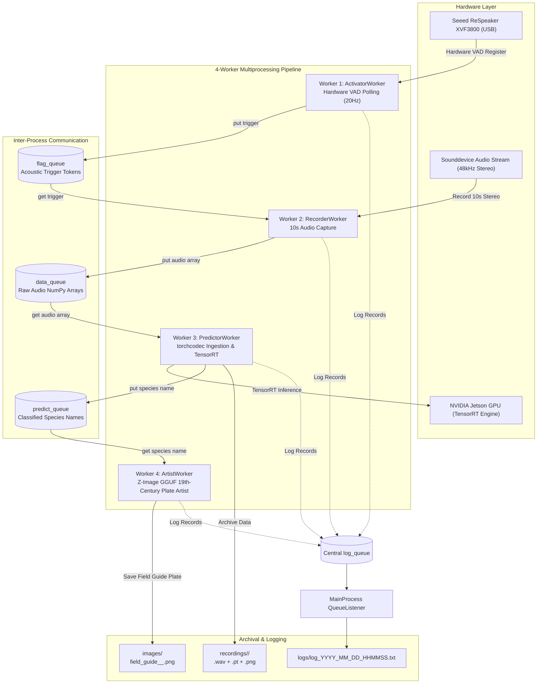

# Bird Acoustic Detection, Identification & 19th-Century Ornithology Field Guide Pipeline

## Overview

[`6_bird_identifier_local_logging_memopt.py`](file:///F:/PycharmProjects/BirdIdentifier/6_bird_identifier_local_logging_memopt.py) (and [`6_bird_identifier_local_logging.py`](file:///F:/PycharmProjects/BirdIdentifier/6_bird_identifier_local_logging.py)) is an automated, real-time edge computing pipeline designed for bird acoustic detection, neural species classification, and vintage ornithological field guide illustration. It operates completely **offline** without internet access on the **NVIDIA Jetson Orin Nano** (Jetpack 7.2 / Tegra R39.2 / Ubuntu 24.04 LTS Noble Numbat) using hardware acceleration and local quantized generative AI.

The pipeline features a unified, process-safe multiprocess logging system and **zero-collision VRAM memory optimization**: immediately following classification, the TensorRT execution engine, context, and GPU buffers are completely freed from memory before placing the prediction onto the IPC queue, ensuring maximum memory headroom for local generative image illustration.

---

## Target Platform & Hardware Requirements

- **Compute Platform**: NVIDIA Jetson Orin Nano (8GB Unified Memory Architecture / UMA)
- **Acoustic Sensor**: Seeed Studio ReSpeaker XVF3800 4-Mic Array (USB VID `0x2886`, PID `0x001A`)
- **Audio Capture**: 48kHz, 2-channel stereo, 32-bit floating-point PCM
- **Inference Acceleration**: TensorRT execution engine (`models/us/BirdID_US.trt`) with PyCUDA pinned host memory and asynchronous CUDA streams
- **Generative Illustration Model**: Local 8-bit quantized GGUF foundation model at `models/Z-Image-AbliteratedV1.Q8_0.gguf` (100% offline execution)

---

## System Architecture

The pipeline employs a supervised parent-child multi-process architecture with 4 dedicated worker processes communicating through memory-bounded IPC queues (`maxsize=5`):



---

## Detailed Worker Process Functionality

### 1. `ActivatorWorker` (`activate`)
- **Role**: Continuously monitors the Seeed Studio ReSpeaker XVF3800 microphone array over USB for Voice/Acoustic Activity Detection (VAD).
- **Polling Loop**: Executes non-blocking hardware control transfers at 20Hz (every 50ms) to query the XVF3800 VAD register.
- **Trigger Dispatch**: When acoustic energy is detected and the system is not in a cooldown state, it enqueues a trigger flag (`True`) into `flag_queue` and asserts the `cooldown_event`.
- **Resilience**: Automatically detects USB reconnection events and handles transient USB communication glitches with automatic retry.

### 2. `RecorderWorker` (`record`)
- **Role**: High-fidelity acoustic capture upon receiving activation triggers.
- **Queue Retrieval**: Blocks with a 1.0s timeout on `flag_queue` to maintain responsiveness to parent shutdown signals.
- **Audio Capture**: Automatically binds to the ReSpeaker XVF3800 audio device and records a 10-second audio clip at 48kHz stereo (2-channel, float32).
- **Queue Access**: Pushes the resulting NumPy audio array into `data_queue` for downstream ingestion.

### 3. `PredictorWorker` (`predict`)
- **Role**: Zero-allocation audio ingestion, spectrogram feature extraction, on-demand TensorRT species identification, memory reclamation, and archival.
- **In-Memory Audio Ingestion**: [`AudioPrep`](file:///F:/PycharmProjects/BirdIdentifier/6_bird_identifier_local_logging_memopt.py#L182) synthesizes a standard 44-byte RIFF/WAV header directly in memory and wraps contiguous audio memory into a `torch.uint8` buffer passed to `torchcodec.decoders.AudioDecoder`. This avoids temporary disk files or intermediate byte stream overhead.
- **Mel-Spectrogram Generation**: Transforms decoded mono audio into a log-Mel spectrogram (`n_fft=2048`, `hop_length=512`, `n_mels=128`), scaled to decibels and resized to `(64, 256)`.
- **Toolbox Integration**: Normalizes features using [`scale_minmax`](file:///F:/PycharmProjects/BirdIdentifier/toolbox/toolbox.py#L110) imported directly from [`toolbox/toolbox.py`](file:///F:/PycharmProjects/BirdIdentifier/toolbox/toolbox.py).
- **On-Demand TensorRT Acceleration**: Executes inference via [`TensorRTInference`](file:///F:/PycharmProjects/BirdIdentifier/6_bird_identifier_local_logging_memopt.py#L254) using PyCUDA pinned host memory and async CUDA streams. If TensorRT or the model engine (`models/us/BirdID_US.trt`) is unavailable, it gracefully fails over to simulated development mode.
- **Taxonomy Resolution**: Resolves predicted class IDs to scientific bird names using `class_mapping_us.csv`.
- **Multi-Modal Archiving**: Automatically creates a species-specific folder under `recordings/<sanitized_species_name>/` and archives:
  1. The raw 10-second audio recording as a lossless WAV file (`recording_<timestamp>.wav` @ 48kHz PCM16).
  2. The Mel-spectrogram PyTorch tensor (`melspec_<timestamp>.pt`).
  3. A normalized visual grayscale representation of the spectrogram (`melspec_<timestamp>.png`).
- **Zero-Collision Memory Deallocation**: Immediately after inference and archiving, the TensorRT engine, execution context, PyCUDA buffers, and CUDA streams are **completely deallocated and freed from memory before placing the prediction on `predict_queue`**. This guarantees that the GPU Unified Memory (UMA) is 100% free when the `ArtistWorker` initiates generative image synthesis.
- **Artist Queue Access**: Pushes the resolved species name into `predict_queue`.

### 4. `ArtistWorker` (`draw`)
- **Role**: 19th-century vintage ornithology field guide plate illustration.
- **Local Offline Generative Model**: Uses the local quantized model located at relative path `models/Z-Image-AbliteratedV1.Q8_0.gguf` (resolved relative to the script directory).
- **Zero Internet Requirement**: Strictly disables online telemetry and network downloads (`HF_HUB_OFFLINE=1`, `TRANSFORMERS_OFFLINE=1`, `local_files_only=True`).
- **Prompt Formulation**: Crafts structured John James Audubon scientific prompts:
  > *"A 19th-century vintage ornithology field guide book illustration plate of the bird: '{bird_name}'. Detailed scientific illustration in the style of John James Audubon, hand-colored engraving, fine plumage textures, naturalistic perch on a botanical branch, aged antique parchment paper with fine grain, botanical watercolor notes, copperplate Latin binomial inscription at bottom, archival museum plate."*
- **Execution Runners**:
  1. **Diffusers / PyTorch**: Single-file GGUF pipeline execution (`ZImagePipeline` or `DiffusionPipeline.from_single_file`) with immediate memory freeing (`del pipe; torch.cuda.empty_cache(); gc.collect()`) to preserve memory bandwidth for TensorRT.
  2. **Local CLI Runner**: Checks for local offline execution binaries (such as `sd`, `stable-diffusion-cli`, or `z-image`).
- **Resilient Archival Fallback**: If the local model file is not yet deployed or execution fails, it renders an authentic 19th-century parchment field guide plate fallback with antique paper grain, double-rule ink borders, botanical vignettes, and Latin binomial typography.
- **Output**: Saves plate illustration in `images/field_guide_<timestamp>_<bird_name>.png`.

---

## Multiprocess Logging Infrastructure

The pipeline implements a central, asynchronous logging infrastructure designed specifically for multiprocessing:

### Central Architecture
- **Queue-Based Transport**: Worker processes emit log records into a dedicated multiprocessing queue (`mp.Queue(-1)`).
- **Non-blocking Execution**: Worker processes never block on disk I/O when writing log messages.
- **Central QueueListener**: The parent process runs a `QueueListener` thread that serializes log records and writes them synchronously to:
  1. The daily session log file (`logs/log_YYYY_MM_DD_HHMMSS.txt`).
  2. The standard output console (`sys.stdout`).

### Folder & File Notation
- **Directory**: The `logs/` directory is automatically created upon script startup if it does not already exist.
- **Filename Notation**: Daily session logs follow the exact timestamp specification:
  ```
  logs/log_YYYY_MM_DD_HHMMSS.txt
  ```
  *(Example: `logs/log_2026_11_02_032800.txt`)*

### Process Attribution Format
Every log entry explicitly attributes the originating process:
```
[YYYY-MM-DD HH:MM:SS] [LEVEL] [PROCESS_NAME] Message
```

### Severity Level Hierarchy
| Level | Purpose | Examples |
| :--- | :--- | :--- |
| **`INFO`** | Normal operational events, lifecycle checkpoints, and IPC queue operations | Process startup/exit, queue access (`put`) and retrieval (`get`), acoustic trigger detection, audio recording finished, spectrogram computed, inference classification, data archiving, plate saved, cooldown cycle started/ended. |
| **`WARNING`** | Non-fatal exceptions where the system recovers gracefully and continues execution | ReSpeaker USB reconnection retries, USB transfer non-fatal timeouts, queue put timeout on full buffers, missing TensorRT engine falling back to simulation mode, missing GGUF model falling back to archival vintage plate generator. |
| **`ERROR`** | Critical issues or exceptions that break functionality or terminate execution | Child worker process dying unexpectedly during parent supervision, unhandled fatal exceptions terminating a worker loop, queue pipeline destruction. |

### Sample Log Output
```
[2026-11-02 03:28:00] [INFO] [MainProcess] Active Session Daily Log File: F:\PycharmProjects\BirdIdentifier\logs\log_2026_11_02_032800.txt
[2026-11-02 03:28:00] [INFO] [MainProcess] Starting child worker processes...
[2026-11-02 03:28:00] [INFO] [MainProcess] ArtistWorker successfully started (PID: 4120)
[2026-11-02 03:28:00] [INFO] [MainProcess] PredictorWorker successfully started (PID: 4121)
[2026-11-02 03:28:00] [INFO] [MainProcess] RecorderWorker successfully started (PID: 4122)
[2026-11-02 03:28:00] [INFO] [MainProcess] ActivatorWorker successfully started (PID: 4123)
[2026-11-02 03:28:01] [INFO] [ActivatorWorker] Successfully bound to ReSpeaker XVF3800. Monitoring for acoustic triggers...
[2026-11-02 03:28:05] [INFO] [ActivatorWorker] Acoustic trigger detected by ReSpeaker XVF3800! Preparing to notify Recorder...
[2026-11-02 03:28:05] [INFO] [ActivatorWorker] Accessing flag_queue: putting trigger flag (True)...
[2026-11-02 03:28:05] [INFO] [ActivatorWorker] Accessing flag_queue: successfully enqueued trigger flag.
[2026-11-02 03:28:05] [INFO] [RecorderWorker] Retrieving from flag_queue: received trigger token: True
[2026-11-02 03:28:05] [INFO] [RecorderWorker] Recording 10s audio clip at 48000Hz (channels=2)...
[2026-11-02 03:28:15] [INFO] [RecorderWorker] Audio capture complete. Audio array shape: (480000, 2)
[2026-11-02 03:28:15] [INFO] [RecorderWorker] Accessing data_queue: putting captured audio array payload...
[2026-11-02 03:28:15] [INFO] [RecorderWorker] Accessing data_queue: successfully enqueued audio array payload.
[2026-11-02 03:28:15] [INFO] [PredictorWorker] Retrieving from data_queue: successfully retrieved audio array (shape: (480000, 2))
[2026-11-02 03:28:15] [INFO] [PredictorWorker] Generating log-Mel spectrogram via torchcodec AudioDecoder...
[2026-11-02 03:28:16] [INFO] [PredictorWorker] Executing Jetson TensorRT model inference...
[2026-11-02 03:28:16] [INFO] [PredictorWorker] Classification result: species identified as 'Melozone fusca' (ClassID: 5)
[2026-11-02 03:28:16] [INFO] [PredictorWorker] Archived detection data to 'recordings/Melozone_fusca': Audio: recording_20261102-032816.wav, Spectrogram: melspec_20261102-032816.pt & melspec_20261102-032816.png
[2026-11-02 03:28:16] [INFO] [PredictorWorker] Accessing predict_queue: putting prediction 'Melozone fusca'...
[2026-11-02 03:28:16] [INFO] [PredictorWorker] Accessing predict_queue: successfully enqueued prediction 'Melozone fusca'.
[2026-11-02 03:28:16] [INFO] [ArtistWorker] Retrieving from predict_queue: received species 'Melozone fusca' for illustration.
[2026-11-02 03:28:16] [WARNING] [ArtistWorker] Local model file not found at: F:\PycharmProjects\BirdIdentifier\models\Z-Image-AbliteratedV1.Q8_0.gguf. Gracefully failing over to archival vintage plate generator fallback.
[2026-11-02 03:28:17] [INFO] [ArtistWorker] Successfully saved field guide illustration plate: images/field_guide_20261102-032817_Melozone_fusca.png
[2026-11-02 03:28:17] [INFO] [MainProcess] Cooldown cycle initiated (600s). VAD trigger polling paused.
```

---

## Toolbox Function Integration

To ensure clean modularity and avoid code duplication, functions already implemented in [`toolbox/toolbox.py`](file:///F:/PycharmProjects/BirdIdentifier/toolbox/toolbox.py) are directly imported rather than re-implemented:
- [`get_time_str`](file:///F:/PycharmProjects/BirdIdentifier/toolbox/toolbox.py#L1343): Formats session and archival timestamps.
- [`scale_minmax`](file:///F:/PycharmProjects/BirdIdentifier/toolbox/toolbox.py#L110): Linearly normalizes audio tensors and NumPy arrays to `[0.0, 1.0]`.

```python
from toolbox.toolbox import get_time_str, scale_minmax
```

---

## How to Run

1. **Activate the Environment**:
   ```bash
   conda activate research
   ```

2. **Verify Local Model File Placement**:
   Ensure the local GGUF model is placed at:
   ```
   models/Z-Image-AbliteratedV1.Q8_0.gguf
   ```
   *(If not present, the pipeline will log a `WARNING` and automatically render authentic archival field guide plates using the built-in vintage generator without crashing).*

3. **Execute the Pipeline**:
   ```bash
   python 6_bird_identifier_local_logging_memopt.py
   ```

4. **Monitoring Logs in Real-Time**:
   ```bash
   # Linux / Jetson
   tail -f logs/log_*.txt

   # Windows PowerShell
   Get-Content (Get-ChildItem logs/log_*.txt | Select-Object -Last 1).FullName -Wait
   ```

5. **Graceful Shutdown**:
   Press `Ctrl+C`. The parent process will:
   - Set the global `stop_event`.
   - Inject `None` sentinel tokens to unblock waiting queues.
   - Wait up to 3.0 seconds per worker process before forcing termination.
   - Flush and safely close the logging file handler.
