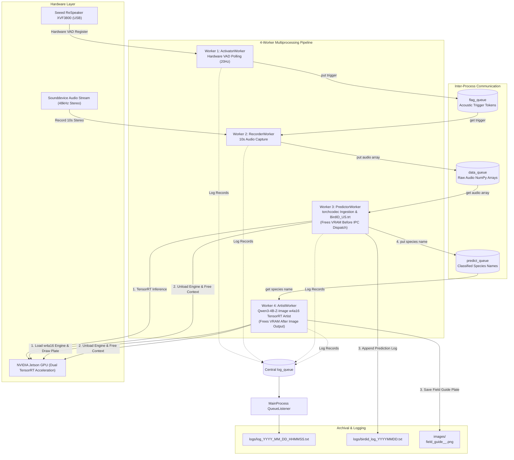

# Bird Acoustic Detection, Identification & 19th-Century Ornithology Field Guide Pipeline

## Overview

[`5_bird_identifier_w4a16_trt.py`](file:///F:/PycharmProjects/BirdIdentifier/5_bird_identifier_w4a16_trt.py) (based on [`5.py`](file:///F:/PycharmProjects/BirdIdentifier/5.py)) is an automated, real-time edge computing pipeline designed for bird acoustic activity detection, neural species classification, and vintage ornithological field guide illustration. It operates completely **offline** without internet access on the **NVIDIA Jetson Orin Nano** (Jetpack 7.2 / Tegra R39.2 / Ubuntu 24.04 LTS Noble Numbat) using dual TensorRT hardware acceleration.

The pipeline features a unified, process-safe multiprocess logging system and **bidirectional zero-collision VRAM memory deallocation**:
1. **Predictor-to-Artist Sequential Deallocation**: Immediately after classifying the bird with the `BirdID_US.trt` engine, the predictor worker completely unloads the model from memory and frees the execution context **before** placing the predicted bird binomial name onto the inter-process communication (IPC) queue (`predict_queue`).
2. **Post-Illustration Artist Deallocation**: Immediately after the artist child process's TensorRT model produces its image output, the model and execution context are completely unloaded and freed from memory.

This guarantees 100% memory headroom so the 8GB Unified Memory Architecture (UMA) on the Jetson Orin Nano is never overwhelmed by concurrent large model contexts, preventing Out-Of-Memory (OOM) errors.

---

## Target Platform & Hardware Requirements

- **Compute Platform**: NVIDIA Jetson Orin Nano (8GB Unified Memory Architecture / UMA)
- **Acoustic Sensor**: Seeed Studio ReSpeaker XVF3800 4-Mic Array (USB VID `0x2886`, PID `0x001A`)
- **Audio Capture**: 48kHz, 2-channel stereo, 32-bit floating-point PCM
- **Classification Acceleration Engine**: TensorRT execution engine (`models/us/BirdID_US.trt`) with PyCUDA pinned host memory and asynchronous CUDA streams
- **Artist Drawing Model**: Local TensorRT model at `models/Qwen3-4B-Z-Image-AbliteratedV1-w4a16.trt` (100% offline execution; no Internet connection required)

---

## System Architecture

The pipeline employs a supervised parent-child multi-process architecture with 4 dedicated worker processes communicating through memory-bounded IPC queues (`maxsize=5`):



---

## Detailed Worker Process Functionality

### 1. `ActivatorWorker` (`activate`)
- **Role**: Continuously monitors the Seeed Studio ReSpeaker XVF3800 microphone array over USB for Voice/Acoustic Activity Detection (VAD).
- **Polling Loop**: Executes non-blocking hardware control transfers at 20Hz (every 50ms) to query the XVF3800 VAD register (`resid=20`, `cmdid=0x80 | 18`).
- **Trigger Dispatch**: When acoustic energy is detected and the system is not in a cooldown state, it logs the event, enqueues a trigger flag (`True`) into `flag_queue`, and asserts the `cooldown_event`.
- **Resilience**: Automatically catches USB control transfer exceptions and handles device reconnection gracefully.

### 2. `RecorderWorker` (`record`)
- **Role**: High-fidelity acoustic capture upon receiving activation triggers.
- **Queue Retrieval**: Blocks with a 1.0s timeout on `flag_queue` to maintain responsiveness to parent shutdown signals.
- **Audio Capture**: Automatically binds to the ReSpeaker XVF3800 audio device and records a 10-second audio clip at 48kHz stereo (2-channel, float32 PCM).
- **Queue Access**: Pushes the resulting NumPy audio array into `data_queue` for downstream ingestion.

### 3. `PredictorWorker` (`predict`)
- **Role**: Zero-allocation audio ingestion, spectrogram feature extraction, on-demand TensorRT species identification, memory reclamation, and taxonomic logging.
- **In-Memory Audio Ingestion**: [`AudioPrep`](file:///F:/PycharmProjects/BirdIdentifier/5_bird_identifier_w4a16_trt.py#L196) synthesizes a standard 44-byte RIFF/WAV header directly in memory and wraps contiguous audio memory into a `torch.uint8` buffer passed to `torchcodec.decoders.AudioDecoder`. This avoids temporary disk files or intermediate byte stream overhead.
- **Mel-Spectrogram Generation**: Transforms decoded mono audio into a log-Mel spectrogram (`n_fft=2048`, `hop_length=512`, `n_mels=128`), scaled to decibels and resized to `(64, 256)`.
- **Toolbox Integration**: Normalizes features using [`scale_minmax`](file:///F:/PycharmProjects/BirdIdentifier/toolbox/toolbox.py#L110) imported directly from [`toolbox/toolbox.py`](file:///F:/PycharmProjects/BirdIdentifier/toolbox/toolbox.py).
- **On-Demand TensorRT Acceleration**: Executes inference via [`TensorRTInference`](file:///F:/PycharmProjects/BirdIdentifier/5_bird_identifier_w4a16_trt.py#L274) using PyCUDA pinned host memory and async CUDA streams. If TensorRT or the model engine (`models/us/BirdID_US.trt`) is unavailable, it gracefully fails over to simulated development mode.
- **Taxonomy Resolution**: Resolves predicted class IDs to scientific bird names using `class_mapping_us.csv`.
- **Prediction Logging**: Appends the classified bird binomial name and timestamp into `logs/birdid_log_YYYYMMDD.txt` using [`DirectoryAccessor`](file:///F:/PycharmProjects/BirdIdentifier/toolbox/toolbox.py#L297) and [`get_time_str`](file:///F:/PycharmProjects/BirdIdentifier/toolbox/toolbox.py#L1343) from [`toolbox/toolbox.py`](file:///F:/PycharmProjects/BirdIdentifier/toolbox/toolbox.py).
- **Zero-Collision Sequential Memory Deallocation**:
  > [!IMPORTANT]
  > When the predictor child accesses its retrieval queue (`data_queue`) and uses `BirdID_US.trt` to obtain the predicted bird binomial name, **before the bird's name is placed into `predict_queue`**, the model engine, execution context, runtime, and PyCUDA device buffers are completely freed from memory (`model.free_resources()`, `del model`, `torch.cuda.empty_cache()`, `gc.collect()`). This ensures the Jetson Orin Nano's unified memory (UMA) is completely unburdened before `ArtistWorker` loads its model.
- **Artist Queue Access**: Pushes the resolved species name into `predict_queue`.

### 4. `ArtistWorker` (`draw`)
- **Role**: 19th-century vintage ornithology field guide plate illustration.
- **Local Offline TensorRT Engine**: Uses the local TensorRT model located at relative path `models/Qwen3-4B-Z-Image-AbliteratedV1-w4a16.trt` (resolved relative to the script directory).
- **Zero Internet Requirement**: Strictly offline execution. No web requests, downloads, or remote endpoints are used during program execution.
- **Prompt Formulation**: Crafts structured John James Audubon scientific prompts:
  > *"A 19th-century vintage ornithology field guide book illustration of the bird: {name}. Detailed, scientific illustration style, aged antique paper, sketched, watercolor notes."*
- **Post-Inference Memory Deallocation**:
  > [!IMPORTANT]
  > After the artist child process's model produces its image output, the model and execution context are immediately unloaded and freed from memory (`trt_model.free_resources()`, `del trt_model`, `torch.cuda.empty_cache()`, `gc.collect()`).
- **Resilient Archival Fallback**: If the local TensorRT model file is not yet deployed or execution fails, it renders an authentic 19th-century parchment field guide plate fallback with antique paper grain, double-rule ink borders, botanical vignettes, and Latin binomial typography.
- **Output**: Saves plate illustrations in `images/field_guide_<timestamp>_<bird_name>.png`.

---

## Multiprocess Logging Infrastructure

The pipeline implements a central, asynchronous logging infrastructure designed specifically for multiprocessing:

### Central Architecture
- **Queue-Based Transport**: Worker processes emit log records into a dedicated multiprocessing queue (`mp.Queue(-1)`).
- **Non-blocking Execution**: Worker processes never block on disk I/O when writing log messages.
- **Central QueueListener**: The parent process runs a `QueueListener` thread that serializes log records and writes them synchronously to:
  1. The daily session log file (`logs/log_YYYY_MM_DD_HHMMSS.txt`).
  2. The standard output console (`sys.stdout`).

### Folder & File Notation
- **Directory**: The `logs/` directory is automatically created upon script startup if it does not already exist.
- **Filename Notation**: Daily session logs follow the exact timestamp specification:
  ```
  logs/log_YYYY_MM_DD_HHMMSS.txt
  ```
  *(Example: `logs/log_2026_11_03_054500.txt`)*

### Process Attribution Format
Every log entry explicitly attributes the originating process:
```
[YYYY-MM-DD HH:MM:SS] [LEVEL] [PROCESS_NAME] Message
```

### Severity Level Hierarchy
| Level | Purpose | Examples |
| :--- | :--- | :--- |
| **`INFO`** | Normal operational events, lifecycle checkpoints, and IPC queue operations | Process startup/exit, queue access (`put`) and retrieval (`get`), acoustic trigger detection, audio recording finished, spectrogram computed, inference classification, model deallocation before IPC queue dispatch, plate generated, model deallocation after image output, cooldown cycle started/ended. |
| **`WARNING`** | Non-fatal exceptions where the system recovers gracefully and continues execution | ReSpeaker USB reconnection retries, USB transfer non-fatal timeouts, queue put timeout on full buffers, missing TensorRT engine falling back to simulation mode, missing artist model falling back to archival vintage plate generator. |
| **`ERROR`** | Critical issues or exceptions that break functionality or terminate execution | Child worker process dying unexpectedly during parent supervision, unhandled fatal exceptions terminating a worker loop, queue pipeline destruction. |

### Sample Log Output
```
[2026-11-03 05:45:00] [INFO] [MainProcess] Active Session Daily Log File: F:\PycharmProjects\BirdIdentifier\logs\log_2026_11_03_054500.txt
[2026-11-03 05:45:00] [INFO] [MainProcess] Starting child worker processes...
[2026-11-03 05:45:00] [INFO] [MainProcess] ArtistWorker successfully started (PID: 6120)
[2026-11-03 05:45:00] [INFO] [MainProcess] PredictorWorker successfully started (PID: 6121)
[2026-11-03 05:45:00] [INFO] [MainProcess] RecorderWorker successfully started (PID: 6122)
[2026-11-03 05:45:00] [INFO] [MainProcess] ActivatorWorker successfully started (PID: 6123)
[2026-11-03 05:45:01] [INFO] [ActivatorWorker] Successfully bound to ReSpeaker XVF3800. Monitoring for acoustic triggers...
[2026-11-03 05:45:05] [INFO] [ActivatorWorker] Acoustic trigger detected by ReSpeaker XVF3800! Preparing to notify Recorder...
[2026-11-03 05:45:05] [INFO] [ActivatorWorker] Accessing flag_queue: putting trigger flag (True)...
[2026-11-03 05:45:05] [INFO] [ActivatorWorker] Accessing flag_queue: successfully enqueued trigger flag.
[2026-11-03 05:45:05] [INFO] [RecorderWorker] Retrieving from flag_queue: received trigger token: True
[2026-11-03 05:45:05] [INFO] [RecorderWorker] Recording 10s audio clip at 48000Hz (channels=2)...
[2026-11-03 05:45:15] [INFO] [RecorderWorker] Audio capture complete. Audio array shape: (480000, 2)
[2026-11-03 05:45:15] [INFO] [RecorderWorker] Accessing data_queue: putting captured audio array payload...
[2026-11-03 05:45:15] [INFO] [RecorderWorker] Accessing data_queue: successfully enqueued audio array payload.
[2026-11-03 05:45:15] [INFO] [PredictorWorker] Retrieving from data_queue: successfully retrieved audio payload (shape: (480000, 2))
[2026-11-03 05:45:15] [INFO] [PredictorWorker] Generating log-Mel spectrogram via AudioPrep...
[2026-11-03 05:45:16] [INFO] [PredictorWorker] Loading BirdID_US.trt TensorRT model/engine for acoustic classification...
[2026-11-03 05:45:16] [INFO] [PredictorWorker] Executing BirdID_US.trt TensorRT inference...
[2026-11-03 05:45:16] [INFO] [PredictorWorker] Predicted bird binomial name: 'Melozone fusca' (ClassID: 5)
[2026-11-03 05:45:16] [INFO] [PredictorWorker] Logged Prediction: Melozone fusca
[2026-11-03 05:45:16] [INFO] [PredictorWorker] Unloading BirdID_US.trt model from memory and freeing context before IPC queue placement...
[2026-11-03 05:45:16] [INFO] [PredictorWorker] BirdID_US.trt TensorRT model and context completely freed from memory.
[2026-11-03 05:45:16] [INFO] [PredictorWorker] Accessing predict_queue: putting prediction 'Melozone fusca'...
[2026-11-03 05:45:16] [INFO] [PredictorWorker] Accessing predict_queue: successfully enqueued 'Melozone fusca'.
[2026-11-03 05:45:16] [INFO] [ArtistWorker] Retrieving from predict_queue: received bird binomial name 'Melozone fusca' for drawing.
[2026-11-03 05:45:16] [INFO] [ArtistWorker] Requesting 19th-century field guide illustration for: Melozone fusca
[2026-11-03 05:45:16] [WARNING] [ArtistWorker] Local TensorRT artist engine not found at: models/Qwen3-4B-Z-Image-AbliteratedV1-w4a16.trt. Gracefully failing over to archival vintage plate generator fallback.
[2026-11-03 05:45:17] [INFO] [ArtistWorker] Freeing artist TensorRT model and context from memory after image output...
[2026-11-03 05:45:17] [INFO] [ArtistWorker] Artist TensorRT model and context completely freed from memory.
[2026-11-03 05:45:17] [INFO] [ArtistWorker] Successfully saved field guide illustration plate: images/field_guide_20261103-054517_Melozone_fusca.png
[2026-11-03 05:45:17] [INFO] [MainProcess] Cooldown cycle initiated (600s). VAD trigger polling paused.
```

---

## Toolbox Function Integration

To ensure clean modularity and eliminate code duplication, functions already implemented in [`toolbox/toolbox.py`](file:///F:/PycharmProjects/BirdIdentifier/toolbox/toolbox.py) are directly imported and called:
- [`get_time_str`](file:///F:/PycharmProjects/BirdIdentifier/toolbox/toolbox.py#L1343): Formats session, log, and archival timestamps.
- [`scale_minmax`](file:///F:/PycharmProjects/BirdIdentifier/toolbox/toolbox.py#L110): Linearly normalizes audio spectrogram tensors and NumPy arrays to `[0.0, 1.0]`.
- [`DirectoryAccessor`](file:///F:/PycharmProjects/BirdIdentifier/toolbox/toolbox.py#L297): Manages thread/process-safe file writing for predictions.

```python
from toolbox.toolbox import get_time_str, scale_minmax, DirectoryAccessor
```

---

## How to Run

1. **Activate the Environment**:
   ```bash
   conda activate research
   ```

2. **Verify Local Model Engine Placement**:
   Ensure the local classification and artist TensorRT engines are located at:
   ```
   models/us/BirdID_US.trt
   models/Qwen3-4B-Z-Image-AbliteratedV1-w4a16.trt
   ```
   *(If the artist engine is not yet generated, the pipeline logs a `WARNING` and automatically renders authentic archival field guide plates using the built-in vintage generator without crashing).*

3. **Execute the Pipeline**:
   ```bash
   python 5_bird_identifier_w4a16_trt.py
   ```

4. **Monitoring Logs in Real-Time**:
   ```bash
   # Linux / Jetson
   tail -f logs/log_*.txt

   # Windows PowerShell
   Get-Content (Get-ChildItem logs/log_*.txt | Select-Object -Last 1).FullName -Wait
   ```

5. **Graceful Shutdown**:
   Press `Ctrl+C`. The parent process will:
   - Set the global `stop_event`.
   - Inject `None` sentinel tokens to unblock waiting queues.
   - Wait up to 3.0 seconds per worker process before forcing termination.
   - Flush and safely close the logging file handler.
