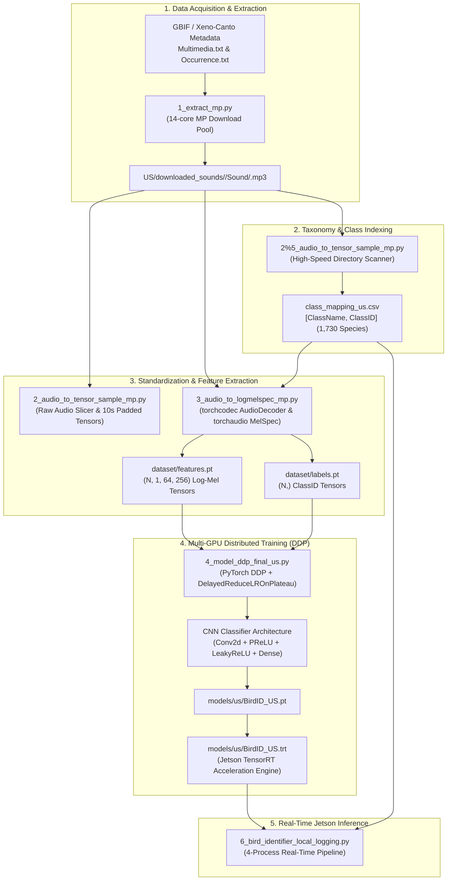

# BirdIdentifier Pipeline Setup & Training Workflow Guide

## Overview

This document provides a comprehensive architectural guide and step-by-step documentation for the five core data preparation, feature extraction, and neural training scripts that constitute the foundation of the **BirdIdentifier** system:

1. [`1_extract_mp.py`](file:///F:/PycharmProjects/BirdIdentifier/1_extract_mp.py) — Distributed multi-process MP3 download pipeline from global biodiversity records.
2. [`2_audio_to_tensor_sample_mp.py`](file:///F:/PycharmProjects/BirdIdentifier/2_audio_to_tensor_sample_mp.py) — Audio standardization, 10-second windowing, and initial raw tensor sampling.
3. [`2%5_audio_to_tensor_sample_mp.py`](file:///F:/PycharmProjects/BirdIdentifier/2%255_audio_to_tensor_sample_mp.py) — Rapid taxonomy indexer and class mapping generator (`class_mapping_us.csv`).
4. [`3_audio_to_logmelspec_mp.py`](file:///F:/PycharmProjects/BirdIdentifier/3_audio_to_logmelspec_mp.py) — Parallel log-Mel spectrogram feature extraction and tensor collation.
5. [`4_model_ddp_final_us.py`](file:///F:/PycharmProjects/BirdIdentifier/4_model_ddp_final_us.py) — Distributed Data Parallel (DDP) multi-GPU training, validation, and TensorRT export for 1,730 US bird species.

---

## End-to-End Pipeline Data Flow



---

## Detailed File Analysis

### 1. `1_extract_mp.py`
**Purpose**: High-throughput distributed downloader that parses global biodiversity occurrence archives and downloads corresponding raw audio files for United States avifauna.

- **Inputs**:
  - `Multimedia.txt`: Tab-delimited metadata containing file identifiers (`Identifier`), media types (`type`), and core foreign keys (`CoreId`).
  - `Occurrence.txt`: Occurrence records containing taxon names (`scientificName`), geographic regions (`country`), and record IDs (`id`).
- **Core Processing Logic**:
  1. Merges `Multimedia.txt` and `Occurrence.txt` on `CoreId == id`.
  2. Filters specifically for `type == 'Sound'` and `country == 'United States'`.
  3. Sanitizes filenames and directory paths to strip invalid filesystem characters (`[\\/*?:"<>|]`).
  4. Generates a structured local directory:
     ```
     US/downloaded_sounds/<Scientific_Name>/Sound/<record_id>.mp3
     ```
  5. Implements multi-threaded HTTP streaming downloads with a 15-second timeout, 10MB chunked disk writes, and exponential retry backoff (up to 5 attempts per file) to handle unstable remote servers gracefully.
- **Multiprocessing Strategy**:
  - Uses `multiprocessing.Pool(processes=14)` initialized with `init_worker` to ignore `SIGINT` (Ctrl+C) in children, allowing the parent process to manage graceful shutdown cleanly via an `mp.Event`.
  - Dispatches tasks using `pool.imap_unordered` with real-time interactive progress monitoring via `alive_progress`.
- **Outputs**:
  - Directory hierarchy populated with raw MP3 files under `US/downloaded_sounds/`.

---

### 2. `2_audio_to_tensor_sample_mp.py`
**Purpose**: Audio standardization, sample rate normalization, and fixed 10-second audio tensor extraction.

- **Inputs**:
  - Directory `US/` containing downloaded audio recordings.
- **Core Processing Logic**:
  1. Recursively scans `US/` for `.mp3` files.
  2. Evaluates native sample rates using `librosa.load`:
     - Files with sample rate $< 44,100\text{ Hz}$ are rejected as unsupported.
     - Files with sample rate $> 44,100\text{ Hz}$ are dynamically resampled to $44,100\text{ Hz}$.
  3. Converts samples to 16-bit PCM (`int16`), exports through an in-memory byte buffer via `pydub.AudioSegment`, and decodes using `torchcodec.decoders.AudioDecoder`.
  4. Extracts standardized 10-second audio windows:
     - If $\text{duration} > 20\text{s}$: extracts the range $[10\text{s}, 20\text{s}]$ to avoid introductory handling noise.
     - If $10\text{s} < \text{duration} \le 20\text{s}$: extracts from the beginning $[0\text{s}, 10\text{s}]$.
     - If $\text{duration} < 10\text{s}$: zero-pads the right side to reach exactly $441,000$ samples ($10\text{s} \times 44.1\text{kHz}$).
  5. Groups samples by scientific species name, pads missing samples per class to equalize list dimensions, and converts to a unified PyTorch tensor.
- **Outputs**:
  - `class_mapping.csv`: Maps sequential `ClassID` integers to `ClassName`.
  - `dataset/audio_dataset.pt`: Tensor of shape `(Num_Classes, Samples_Per_Class, 1, 441000)`.

---

### 3. `2%5_audio_to_tensor_sample_mp.py`
**Purpose**: Ultra-fast taxonomy extraction and canonical class mapping generator (Step 2.5).

- **Specialized Role**:
  Unlike `2_audio_to_tensor_sample_mp.py`, which performs complete audio decoding and resampling, this specialized script focuses on **extracting unique species nomenclature across all downloaded files in seconds**. It establishes the definitive taxonomy mappings required by both the training pipeline and the edge deployment engine.
- **Inputs**:
  - Downloaded audio filesystem structure under `US/`.
- **Core Processing Logic**:
  1. Gathers all MP3 file paths matching `US/**/*.mp3`.
  2. Spawns a 14-core worker pool (`mp.Pool(processes=14)`).
  3. Worker function `process_mp3` extracts the species directory name directly from the path parts (`Path(file_path).parts[-3]`) without opening or decoding the audio payloads.
  4. Deduplicates species into an ordered dictionary (`numpy_dict`).
  5. Assigns an index `0, 1, 2, ..., N-1` to every unique species name.
  6. Writes out `class_mapping_us.csv` with standardized headers `["ClassName", "ClassID"]`.
- **Outputs**:
  - `class_mapping_us.csv`: Standardized taxonomy map indexing all 1,730 species found in the US dataset. This file is directly loaded by `3_audio_to_logmelspec_mp.py`, `4_model_ddp_final_us.py`, and `6_bird_identifier_local_logging.py`.

---

### 4. `3_audio_to_logmelspec_mp.py`
**Purpose**: Parallel log-Mel spectrogram feature extraction pipeline converting raw audio into 2D time-frequency spectrogram tensors for computer vision models.

- **Inputs**:
  - `US/**/*.mp3` audio files.
  - `class_mapping_us.csv` (generated by `2%5_audio_to_tensor_sample_mp.py`).
- **Core Processing Logic**:
  1. Reads `class_mapping_us.csv` to resolve scientific names to numeric class targets.
  2. Decodes 15-second mono audio directly using `torchcodec.decoders.AudioDecoder`:
     - If $\text{duration} > 25\text{s}$: extracts slice $[5\text{s}, 20\text{s}]$.
     - If $15\text{s} < \text{duration} \le 25\text{s}$: extracts slice $[0\text{s}, 15\text{s}]$.
     - If $\text{duration} \le 15\text{s}$: applies symmetric constant zero-padding (`F.pad`).
  3. Computes log-Mel spectrogram features using `torchaudio.transforms.MelSpectrogram`:
     - $\text{sample\_rate} = \text{decoder sample rate}$
     - $n_{\text{fft}} = 2048$
     - $\text{hop\_length} = 512$
     - $n_{\text{mels}} = 128$
  4. Converts power amplitude to decibels via `torchaudio.transforms.AmplitudeToDB(stype="power")`.
  5. Resizes spectrogram to fixed dimensions `(64, 256)` using `torchvision.transforms.v2.Resize`.
  6. Linearly normalizes pixel values to $[0.0, 1.0]$.
  7. Corrupt or unreadable audio files that trigger exceptions are automatically logged and removed (`os.remove`) to sanitize the training set.
  8. Stacks all spectrogram tensors and labels.
- **Outputs**:
  - `dataset/features.pt`: PyTorch tensor of shape `(N, 1, 64, 256)` containing normalized Mel-spectrograms.
  - `dataset/labels.pt`: PyTorch tensor of shape `(N,)` containing class IDs.

---

### 5. `4_model_ddp_final_us.py`
**Purpose**: Multi-GPU Distributed Data Parallel (DDP) training, validation, and optimization of the deep neural classifier, followed by export to ONNX and TensorRT.

- **Inputs**:
  - `dataset/features_us.pt` (or `features.pt`)
  - `dataset/labels_us.pt` (or `labels.pt`)
- **Neural Network Architecture (`Discriminator`)**:
  - Input: Mel-spectrogram tensor $(B, 1, 64, 256)$
  - 2D Convolution: `Conv2d(1, 32, kernel_size=2, padding="valid")` with `PReLU` activation
  - Flattening: Produces 514,080 features
  - Fully Connected Layer 1: `Linear(514080, 1024)` with `PReLU` and `Dropout(0.2)`
  - Fully Connected Layer 2: `Linear(1024, 512)` with `LeakyReLU` and `Dropout(0.2)`
  - Output Classifier Head: `Linear(512, 1730)` producing raw logits for all 1,730 species
- **Distributed Training Engine**:
  - Backend: PyTorch `torch.distributed` with NCCL backend across CUDA device ranks.
  - Mixed Precision: Automatic Mixed Precision (`torch.amp.GradScaler`, bfloat16/float16) with fused Adam optimizer.
  - Custom Scheduling: [`DelayedReduceLROnPlateau`](file:///F:/PycharmProjects/BirdIdentifier/toolbox/toolbox.py#L86) (imported from `toolbox/toolbox.py`) holds learning rate steady for the first 200 epochs before dynamically reducing on plateau.
  - Early Stopping: [`EarlyStopping`](file:///F:/PycharmProjects/BirdIdentifier/toolbox/toolbox.py#L1126) with configurable patience and min-delta threshold.
  - Data Partitioning: 80% train, 17% validation, 3% test split with distributed samplers (`DistributedSamplerWrapper`).
- **Export & Edge Deployment**:
  - Serializes best checkpoint to `models/us/BirdID_US.pt`.
  - Exports trained PyTorch weights to Open Neural Network Exchange format (`BirdID_US.onnx`).
  - Compiles the ONNX graph into an optimized NVIDIA TensorRT engine (`BirdID_US.trt`) for zero-copy UMA execution on the Jetson Orin Nano.

---

## Complete Execution Sequence

Follow this sequence to reproduce the entire pipeline from scratch:

```bash
# Step 1: Download raw audio records from GBIF metadata
python 1_extract_mp.py

# Step 2: Standardize raw 10-second audio tensors
python 2_audio_to_tensor_sample_mp.py

# Step 2.5: Index all species and generate class mapping CSV
python 2%5_audio_to_tensor_sample_mp.py

# Step 3: Extract log-Mel spectrograms and generate dataset tensors
python 3_audio_to_logmelspec_mp.py

# Step 4: Train model across multiple GPUs with Distributed Data Parallel
python 4_model_ddp_final_us.py --world_size 2 --num_epochs 500 --save_model

# Step 5: Deploy real-time edge listener on Jetson Orin Nano
python 6_bird_identifier_local_logging_memopt.py
```
